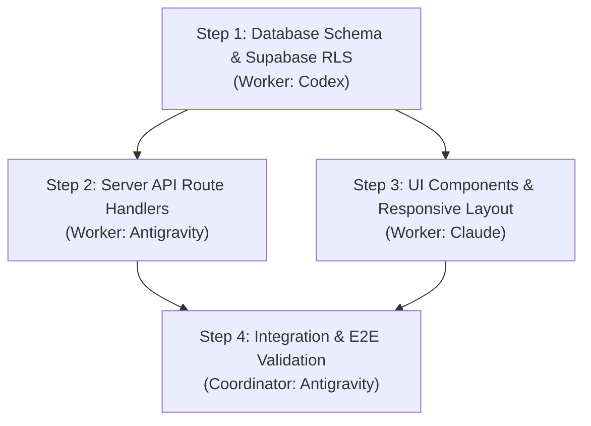

# The 100x Developer Playbook in Orca ADE (`orca-100x-playbook`)

Running **Google Antigravity CLI** inside **Orca ADE** unlocks an order-of-magnitude leap in software engineering throughput. You are no longer an individual developer pairing with a single chat assistant; you are the **Commander of an AI Engineering Fleet**.

---

## 1. The Core Paradigm Shift: 1x vs 10x vs 100x

| Dimension | 1x Traditional Dev | 10x Single Agent Dev | 100x Fleet Orchestrator (Orca + Antigravity) |
| :--- | :--- | :--- | :--- |
| **Execution** | Manual coding & debugging | 1 AI agent coding sequentially in your terminal | 5–10 AI agents working simultaneously in parallel Git worktrees |
| **Workspace** | Single git branch, stashing & switching | Single branch, frequent file overwrites & conflicts | Strictly isolated Git worktrees per task (`orca worktree create`) |
| **Model Diversity** | None | Locked into 1 model (Claude, GPT, or Gemini) | Heterogeneous fleet: Antigravity (planning/TS), Codex (backend), Claude (editorial UI) |
| **Testing & Review** | Manual browser tabs & console logs | Terminal runs, manual browser clicks | Embedded Chromium snapshots (`orca snapshot`), visual diff annotations |
| **Mobility** | Chained to desk | Chained to laptop screen | Orca iOS/Android app: monitor progress, answer questions, merge on the go |

---

## 2. Playbook Strategy 1: Prompt Fan-Out & Parallel Spikes ("Prompt Racing")

When designing a complex component, refactoring an API, or solving an elusive bug, don't guess which implementation will work best. Run a **parallel spike**:

### The Workflow:
1. **Define the Specification**: Write a crisp, unambiguous task requirement (e.g., in a scratch file or prompt).
2. **Dispatch 3 Agents into 3 Worktrees Simultaneously**:
   ```bash
   # Worker 1: Antigravity Subagent (Route Handler + SWR)
   orca orchestration worker-start \
     --spec "Implement faculty directory search with SWR debouncing in src/app/faculty/page.tsx" \
     --worktree new-child --name "spike-swr" --agent antigravity --json

   # Worker 2: Claude Code (Server Actions + URL searchParams)
   orca orchestration worker-start \
     --spec "Implement faculty directory search using Server Actions and URL searchParams" \
     --worktree new-child --name "spike-server-actions" --agent claude --json

   # Worker 3: OpenAI Codex (Edge Route Handler + Redis caching)
   orca orchestration worker-start \
     --spec "Implement faculty directory search using Edge Route Handler with Upstash Redis" \
     --worktree new-child --name "spike-edge-cache" --agent codex --json
   ```
3. **Wait for Deliveries**:
   ```bash
   orca orchestration check --terminal active --wait --types "worker_done" --json
   ```
4. **Compare the 3 Worktrees**:
   ```bash
   orca worktree snapshot --worktree "branch:spike-swr" --json
   orca worktree snapshot --worktree "branch:spike-server-actions" --json
   orca worktree snapshot --worktree "branch:spike-edge-cache" --json
   ```
5. **Merge Winner & Prune Losers**:
   ```bash
   git merge spike-server-actions
   orca worktree remove --worktree "branch:spike-swr" --force --json
   orca worktree remove --worktree "branch:spike-edge-cache" --force --json
   ```

*Result: You discover the optimal architectural trade-off in 4 minutes instead of 4 hours.*

---

## 3. Playbook Strategy 2: The Coordinator-Worker Task DAG

Large features (e.g. building an entire Academic Accreditation portal) must not be dumped into a single agent turn. Decompose them into a Directed Acyclic Graph (DAG):



### Coordinator Protocol:
1. **Architect the Plan**: Use `senior-architect` and create `docs/PLAN.md`.
2. **Dispatch Independent Foundations First**:
   - Dispatch Step 1 (DB migration) in `worktree new-child --name feat-db`.
   - Coordinator monitors mailbox via `orca orchestration check --wait`.
3. **Dispatch Dependent Nodes Once Foundation Signals `worker_done`**:
   - Merge `feat-db` into development branch.
   - Dispatch Step 2 (API) and Step 3 (UI) in parallel!
4. **Coordinate and Resolve Gates**:
   - When Worker 3 asks: *"What is the exact endpoint for NAAC metrics?"*, Coordinator uses `orca orchestration reply` to answer in seconds without breaking Worker 3's flow.
5. **Synthesize & Validate**: Run build, tests, and accessibility audit.

---

## 4. Playbook Strategy 3: The Embedded Browser QA Flywheel

Never rely solely on automated unit tests for visual interfaces. Pair your coding with Orca's built-in Chromium:

1. **Keep Dev Server Running**: Run `npm run dev` in an Orca terminal split.
2. **Live Page Navigation**:
   ```bash
   orca goto --url "http://localhost:3000/admissions" --json
   ```
3. **Multi-Resolution Visual Checks**:
   ```bash
   # Check mobile viewport (390px)
   orca viewport --width 390 --height 844 --json
   orca screenshot --output "brain/screenshots/mobile-audit.png" --json

   # Check desktop viewport (1440px)
   orca viewport --width 1440 --height 900 --json
   orca screenshot --output "brain/screenshots/desktop-audit.png" --json
   ```
4. **Interactive Form Testing**:
   ```bash
   orca snapshot --json
   orca fill --element "@e2" --value "Test Student" --json
   orca click --element "@e5" --json # Submit
   orca screenshot --output "brain/screenshots/form-submitted.png" --json
   ```
5. **Feed Visual Feedback Directly into Agent**: If a button overflows or contrast is poor, attach the screenshot path to your next prompt turn.

---

## 5. Playbook Strategy 4: Mobile & AFK (Away-From-Keyboard) Operations

One of Orca’s superpowers is its **Mobile Companion App** (iOS / Android):

1. **Launch Heavy Tasks Before Leaving**:
   - Kick off a full codebase migration, comprehensive test suite, or multi-worker DAG in Orca desktop.
2. **Monitor on Your Phone**:
   - The Orca mobile app connects via encrypted cloud relay.
   - Review agent diffs line-by-line while getting coffee or commuting.
3. **Push Notifications & Prompt Injection**:
   - If an agent finishes or requests user confirmation, your phone receives a push notification.
   - Type follow-up instructions or hit "Approve" directly from your phone.
   - When you return to your desk, the code is tested, committed, and ready to merge.

---

## 6. Playbook Strategy 5: Worktree Hygiene & Resource Management

Running parallel worktrees consumes disk space and git references if not managed cleanly:

### Golden Rules:
1. **One Worktree = One Specific Goal**: Never keep a worktree alive for longer than the task lifecycle.
2. **Always Snapshot Before Merging**:
   ```bash
   orca worktree snapshot --worktree "branch:feat-auth" --json
   ```
3. **Automated Cleanup**:
   Immediately after merging a branch, prune the worktree:
   ```bash
   orca worktree remove --worktree "branch:feat-auth" --json
   ```
4. **List and Audit Stale Worktrees**:
   ```bash
   orca ps --json
   # Prune any abandoned worktrees
   git worktree prune
   ```

---

## 7. Quick Cheat Sheet: 100x Orca Commands

| Action | Command |
| :--- | :--- |
| **Check Orca Status** | `orca status --json` |
| **List All Worktrees** | `orca ps --json` or `orca worktree list --json` |
| **Create Isolated Worktree** | `orca worktree create --name "<name>" --json` |
| **Take Worktree Diff Snapshot** | `orca worktree snapshot --worktree active --json` |
| **Dispatch Supervised Worker** | `orca orchestration worker-start --spec "<spec>" --worktree new-child --name "<name>" --agent <agent> --json` |
| **Coordinator Wait on Events** | `orca orchestration check --terminal active --wait --types "worker_done,question" --json` |
| **Reply to Blocked Worker** | `orca orchestration reply --to "<dispatch_id>" --delivery "<id>" --body "<answer>" --json` |
| **Navigate Embedded Browser** | `orca goto --url "http://localhost:3000" --json` |
| **Snapshot Browser DOM** | `orca snapshot --json` |
| **Click DOM Element** | `orca click --element "@e1" --json` |
| **Take Browser Screenshot** | `orca screenshot --output "brain/screenshots/qa.png" --json` |
| **Send Keystrokes to Terminal** | `orca terminal send --terminal "<handle>" --text "npm test" --enter --json` |
| **Wait for Agent Idle** | `orca terminal wait --terminal "<handle>" --for tui-idle --timeout-ms 60000 --json` |
| **Prune Finished Worktree** | `orca worktree remove --worktree "branch:<branch>" --json` |
