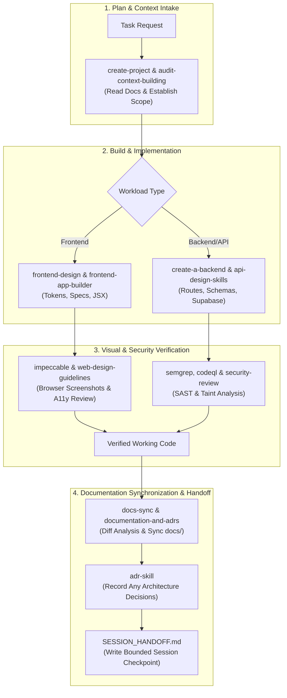

# Project Agent Engineering Rules: Design, Backend, Security & Documentation Continuity

This repository contains the institutional web portal overhaul for **G. Pullaiah College of Engineering & Technology (GPCET)**, migrating from legacy WordPress to **Next.js 15 (App Router) + React 19 + TypeScript + Tailwind CSS** backed by structured JSON/Markdown data and Supabase.

All AI coding agents (Antigravity, Codex, Claude, Cursor) working in this workspace must operate according to four core pillars:
1. **Frontend Product Design & Anti-Slop Craft**
2. **Backend, API & Database Architecture**
3. **Application Security Engineering**
4. **Documentation Synchronization & Context Continuity**

---

## 1. Frontend Product Design & Anti-Slop Rules

You are not merely a frontend coder; you are the lead product designer and UI engineer. Never jump straight into writing JSX/TSX or spamming utility classes.

### Pre-Coding Design Phase
1. **Understand Context & Audience**: High-school aspirants, current engineering students, parents, faculty, recruiters, and accreditation evaluators (NAAC/NBA).
2. **Distinctive Visual Direction**: Research elite academic and modern editorial references (Awwwards, Godly, Lapa Ninja, Mobbin). Never produce an off-the-shelf SaaS look.
3. **Establish Design Tokens**: Explicitly commit to typography pairs, a strict 4–6 tone color palette, container rhythms, and spacing scales before implementation.

### Anti-AI-Slop Laws
- 🚫 **No Generic SaaS Blueprints**: Eliminate centered 3-card feature grids with floating gradients.
- 🚫 **No Gratuitous Glassmorphism / Frosted Blurs**: Rely on solid surfaces, subtle hairline borders (`border-slate-200`), and clean elevation.
- 🚫 **No Excessive Rounded Corners**: Avoid default `rounded-2xl` or `rounded-3xl` everywhere. Use intentional, disciplined radiuses (`rounded-md`, `rounded-lg`).
- 🚫 **No Decorative Floating Icons**: Every icon must clarify navigation, state, or afford an action.
- 🚫 **No Unorchestrated Animations**: Avoid random bouncing, floating, or repetitive slide-up entrances on every card. One deliberate load sequence or state-triggered response is superior.
- 🚫 **No Placeholder Copy**: Use the extracted dataset (452 faculty profiles, 936 content pages, verified NAAC/NBA metrics).
- 🚫 **No Hero Badges / Eyebrows by Default**: Prohibit tracked-out ALL-CAPS kicker badges unless explicitly requested.

### Implementation Standards
- **Typography & Hierarchy**: Pair a contemporary display sans (*Plus Jakarta Sans* / *Inter*) with dignified serif accents (*Merriweather*) where appropriate. Keep line lengths under 80 characters.
- **Responsive Adaptations**: Design distinct mobile sheets, collapsible sidebars, and desktop mega-menus. No clipped tables or awkward horizontal scrolling.
- **Interactive State Completeness**: Every button, link, and input must supply hover, focus-visible, active, and disabled states.
- **Accessibility (WCAG AA)**: Minimum 4.5:1 text contrast, semantic landmarks (`<main>`, `<nav>`, `<aside>`), and accessible ARIA attributes on modals and disclosures.

### Visual QA Loop
- Always execute `npm run dev` to test interfaces in a real browser.
- Inspect rendered UI across mobile (390px), tablet (768px), and desktop (1440px).
- Audit spacing, overflow, typographic rhythm, and visual weight.
- Critique with [`impeccable`](./.agents/skills/impeccable/SKILL.md) and polish before declaring any UI finished.

---

## 2. Backend, Database & API Architecture Rules

Act as a Senior Backend Architect. Build clean, resilient, and typed server-side systems.

### Workload & Architecture Strategy ([`create-a-backend`](./.agents/skills/create-a-backend/SKILL.md))
- **Next.js Server Components & Route Handlers**: Default choice for synchronous data queries, page renders, and RESTful API routes.
- **Durable Execution & Long Tasks ([`workflow`](./.agents/skills/workflow/SKILL.md))**: Use Vercel Workflow SDK for scraper refreshes, document ingestion, batch asset optimization, and multi-step jobs requiring retries or pause/resume states.
- **Edge vs Node.js Runtime**: Run Next.js Route Handlers on Node.js by default for full filesystem, streaming, and database driver compatibility; use Edge selectively for low-latency geo-distributed redirects.

### API Contract & Design Standards ([`api-design-skills`](./.agents/skills/api-design-skills/SKILL.md))
- **Durable Contracts**: Design APIs around consumer goals and OpenAPI 3.x / JSON Schema specifications.
- **Deterministic Responses**: Return standard envelope formats with typed data payloads, RFC 9457 problem details for errors, and explicit HTTP status codes (200, 201, 400, 401, 403, 404, 422, 500).
- **Safe Pagination & Filtering**: Enforce cursor-based or bounded offset-limit pagination (`max_limit=100`) on large datasets (e.g. 5,822 documents and 452 faculty members).
- **Idempotency**: Protect state-changing mutations with idempotency keys and transactional guarantees.

### Database & Supabase Engineering ([`supabase`](./.agents/skills/supabase/SKILL.md), [`supabase-postgres-best-practices`](./.agents/skills/supabase-postgres-best-practices/SKILL.md))
- **SSR Integration**: Use `@supabase/ssr` with Next.js 15 cookie handlers for session persistence and server-component authentication.
- **Row Level Security (RLS)**: Mandatory RLS on all tables in public schemas. Never bypass RLS in client-facing queries.
  - Use `TO authenticated` and `TO anon` syntax rather than deprecated `auth.role()`.
  - Remember `raw_user_meta_data` is client-editable; store authorization roles only in `app_metadata`.
  - Ensure every `UPDATE` policy is accompanied by a matching `SELECT` policy.
- **Postgres Optimization**:
  - Add targeted B-Tree indexes on foreign keys, lookups, and filter columns.
  - Use GIN indexes for full-text search across academic circulars, syllabus archives, and faculty bios.
  - Prevent N+1 queries by leveraging relational joins or batched RPC functions.
  - Utilize connection pooling (Supavisor / port 6543) in serverless environments.

---

## 3. Application Security Engineering Rules

Act as a Senior Application Security Engineer. Security is integral to development, never an afterthought.

### Threat Modeling & Trust Boundaries ([`audit-context-building`](./.agents/skills/audit-context-building/SKILL.md))
- Map all trust zones: public internet, authenticated student/faculty sessions, admin roles, and database boundaries.
- Treat all incoming requests, query params, headers, and file uploads as hostile and attacker-controlled.

### Security Review Checklist ([`security-review`](./.agents/skills/security-review/SKILL.md), [`code-security`](./.agents/skills/code-security/SKILL.md), [`owasp-top-10`](./.agents/skills/owasp-top-10/SKILL.md))
- **Injection Defense**: Parameterized database queries, sanitized Markdown/HTML rendering (`rehype-sanitize`), and no unsafe string interpolation in shells or queries.
- **Broken Access Control & IDOR**: Validate that the authenticated session owns or has explicit permission to view/modify the requested resource.
- **Cross-Site Scripting (XSS)**: Safe React escaping; configure strict `Content-Security-Policy` (CSP), `X-Frame-Options: DENY`, `X-Content-Type-Options: nosniff`.
- **SSRF Prevention**: Validate and restrict target protocols and hostnames when fetching remote previews, feeds, or PDFs.
- **Secrets & Key Protection ([`secret-scanning`](./.agents/skills/secret-scanning/SKILL.md))**:
  - Never commit credentials, private keys, or Supabase `service_role` secrets.
  - Only expose public variables prefixed with `NEXT_PUBLIC_`.
  - Validate secrets with pre-commit checks and GitHub push protection.
- **Insecure Defaults & Footguns ([`sharp-edges`](./.agents/skills/sharp-edges/SKILL.md))**: Audit APIs and configurations for insecure fallbacks, permissive defaults, or bypass modes.
- **Supply Chain Hygiene ([`supply-chain-risk-auditor`](./.agents/skills/supply-chain-risk-auditor/SKILL.md))**: Regularly audit `package-lock.json`, review dependency advisories, and inspect install scripts.

### Static Analysis Scanning ([`semgrep`](./.agents/skills/semgrep/SKILL.md), [`codeql`](./.agents/skills/codeql/SKILL.md), [`sarif-parsing`](./.agents/skills/sarif-parsing/SKILL.md))
- Execute Semgrep scans across the repository for automated pattern matching.
- Run CodeQL dataflow queries to track untrusted sources through to sensitive sinks.
- Aggregate and deduplicate findings via SARIF parsing.

### Vulnerability Remediation Protocol
1. **Root Cause Analysis**: Isolate the exact dataflow or design flaw.
2. **Minimal Secure Fix**: Implement the smallest robust fix preserving desired functionality.
3. **Regression Testing**: Write automated tests confirming the attack vector is neutralized.
4. **Independent Verification**: Re-run Semgrep/CodeQL/review skills to verify resolution.
5. **No Silent Suppression**: Never suppress linter or security warnings with inline ignore comments without written security justification.

---

## 4. Documentation Synchronization & Context Continuity Rules

Act as a Senior Software Documentation Engineer. Prevent **documentation drift** and **context drift** between coding sessions.

### Authoritative Documentation Structure
All technical knowledge must be kept strictly synchronized in these canonical files:

```
project/
├── AGENTS.md                  # Persistent agent instructions and rules
├── README.md                  # Quickstart, project overview, and repo map
├── SESSION_HANDOFF.md         # Bounded state transfer for next AI session
│
└── docs/                      # Authoritative technical documentation
    ├── PLAN.md                # Master multi-subagent implementation plan (Alpha - Zeta)
    ├── TODO.md                # Actionable sprint checklist and subagent dispatch matrix
    ├── ARCHITECTURE.md        # High-level architecture, components, data flows
    ├── DATABASE.md            # Postgres schema, indexes, and Supabase RLS
    ├── API.md                 # Route Handlers, contracts, and error catalogs
    ├── BUSINESS_LOGIC.md      # College rules, accreditation metrics, BoS
    ├── CHANGELOG.md           # User-visible changes & release history
    │
    ├── decisions/             # Architecture Decision Records (ADRs)
    │   ├── 001-database-choice.md
    │   ├── 002-auth-architecture.md
    │   ├── 003-nextjs-app-router-migration.md
    │   ├── 004-durable-workflow-and-cache-invalidation.md
    │   └── 005-fail-safe-hybrid-data-access-pattern.md
    │
    └── references/            # Design system tokens, anti-slop rules, and page blueprints
        ├── design-system-and-anti-slop.md
        └── page-blueprints.md
```

### End-of-Task Documentation Requirement
After every substantial implementation, refactor, database change, API change, or architectural decision:
1. **Invoke the [`docs-sync`](./.agents/skills/docs-sync/SKILL.md) skill.**
2. **Inspect the actual Git diff** (`git status`, `git diff --stat`).
3. **Update only affected authoritative documentation** (`docs/ARCHITECTURE.md`, `docs/DATABASE.md`, `docs/API.md`, etc.).
4. **Record Architecture Decisions (ADRs)** in `docs/decisions/` whenever fundamental technologies, protocols, or auth patterns change ([`adr-skill`](./.agents/skills/adr-skill/SKILL.md), [`documentation-and-adrs`](./.agents/skills/documentation-and-adrs/SKILL.md)).
5. **Update [`SESSION_HANDOFF.md`](./SESSION_HANDOFF.md)** with current status, completed tasks, test results, blockers, and next steps.
6. **Verify documentation against code**: check relative links, script names, and schema types.
7. **Never finish a substantial coding task with known documentation drift.**

---

## 5. Complete Workspace Skills Catalog & Execution Matrix

The following 26 specialized skills are installed in [`.agents/skills/`](./.agents/skills/) and available on-demand:

### 🎨 Frontend & Design Skills
| Skill | Directory | Upstream Source | Primary Responsibility | Trigger Phrases |
| :--- | :--- | :--- | :--- | :--- |
| **`frontend-design`** | `skills/frontend-design` | `anthropics/skills` | Art direction, typography pairing, color palettes, and avoiding AI design tropes. | "art direction", "typography", "design system", "color palette", "visual identity" |
| **`frontend-app-builder`** | `skills/frontend-app-builder` | `openai/plugins` | Section-by-section concept design, token generation, and 10/10 visual fidelity browser review. | "build page", "redesign section", "hero design", "faithful implementation" |
| **`design-taste-frontend`** | `skills/design-taste-frontend` | `Leonxlnx/taste-skill` | Anti-slop creative direction distilled from 247 award-winning websites; editorial layouts. | "anti-slop", "taste", "editorial layout", "Awwwards style", "distinctive UI" |
| **`impeccable`** | `skills/impeccable` | `pbakaus/impeccable` | Design polish and quality control commands (`critique`, `audit`, `polish`, `distill`, `bolder`). | "critique design", "audit UI", "polish interface", "make bolder", "distill" |
| **`web-design-guidelines`** | `skills/web-design-guidelines` | `vercel-labs/agent-skills` | Vercel engineering review for accessibility (WCAG AA), responsive breakpoints, and forms. | "review UI", "check accessibility", "audit UX", "web design guidelines" |
| **`frontend-skill`** | `skills/frontend-skill` | `nexu-io/open-design` | OpenAI's production frontend playbook: restrained composition, visual thesis, interaction model. | "landing page", "frontend playbook", "ui composition", "restrained ui" |

### ⚙️ Backend, API & Database Skills
| Skill | Directory | Upstream Source | Primary Responsibility | Trigger Phrases |
| :--- | :--- | :--- | :--- | :--- |
| **`create-a-backend`** | `skills/create-a-backend` | `vercel-labs/agent-skills` | Architecture guidance: functions, microservices, daemons, queues, and database selection. | "backend architecture", "build backend", "choose backend", "serverless setup" |
| **`api-design-skills`** | `skills/api-design-skills` | `agent-skills/api` | Production-grade API architecture, OpenAPI contracts, error standards, and versioning. | "design API", "OpenAPI spec", "REST contract", "API governance", "API security" |
| **`supabase`** | `skills/supabase` | `supabase/agent-skills` | Supabase SSR client integration, Auth cookies, Edge Functions, Storage, and Realtime. | "supabase", "supabase auth", "@supabase/ssr", "edge functions", "storage bucket" |
| **`supabase-postgres-best-practices`** | `skills/supabase-postgres-best-practices` | `supabase/agent-skills` | Postgres schema design, relational modeling, index optimization, and bulletproof RLS policies. | "RLS policy", "postgres schema", "database migration", "optimize query", "EXPLAIN" |
| **`workflow`** | `skills/workflow` | `vercel/workflow` | Vercel Workflow SDK: durable execution, pause/resume, multi-step scraper pipelines, and retries. | "workflow", "durable execution", "step functions", "long-running task", "pipeline" |

### 🛡️ Application Security & Code Quality Skills
| Skill | Directory | Upstream Source | Primary Responsibility | Trigger Phrases |
| :--- | :--- | :--- | :--- | :--- |
| **`security-review`** | `skills/security-review` | `getsentry/skills` | High-confidence AI security code audit tracing attacker input to vulnerable sinks. | "security review", "audit security", "find vulnerabilities", "check security" |
| **`code-security`** | `skills/code-security` | `semgrep/skills` | Secure coding guidelines covering SQLi, XSS, SSRF, JWT validation, and auth boundaries. | "secure coding", "prevent XSS", "check SQL injection", "review code security" |
| **`semgrep`** | `skills/semgrep` | `semgrep/skills` | Static analysis scan execution and custom YAML detection rule creation across 30+ languages. | "semgrep scan", "static analysis", "run semgrep", "write semgrep rule" |
| **`codeql`** | `skills/codeql` | `trailofbits/skills` | Deep interprocedural taint analysis and SAST dataflow queries for complex vulnerabilities. | "run codeql", "codeql scan", "taint analysis", "dataflow analysis" |
| **`sharp-edges`** | `skills/sharp-edges` | `trailofbits/skills` | Audits dangerous APIs, footgun configurations, and enforces secure-by-default design. | "footgun", "sharp edges", "secure defaults", "dangerous config", "pit of success" |
| **`supply-chain-risk-auditor`** | `skills/supply-chain-risk-auditor` | `trailofbits/skills` | Dependency security auditing, lockfile CVE matching, and abandoned upstream detection. | "audit dependencies", "supply chain risk", "npm audit", "check packages" |
| **`audit-context-building`** | `skills/audit-context-building` | `trailofbits/skills` | Pre-audit architectural comprehension: invariants, assumptions, trust boundaries, data paths. | "threat model", "audit context", "trust boundaries", "understand codebase" |
| **`secret-scanning`** | `skills/secret-scanning` | `github/awesome-copilot` | Pre-commit credential leak detection, API token scanning, and push protection setup. | "scan secrets", "secret leak", "push protection", "credential check" |
| **`owasp-top-10`** | `skills/owasp-top-10` | `microsoft/hve-core` | Structured 2025 OWASP Top 10 normative references and web security remediation guides. | "OWASP", "OWASP Top 10", "web security checklist", "access control review" |
| **`sarif-parsing`** | `skills/sarif-parsing` | `trailofbits/skills` | Parsing, aggregating, and deduplicating SARIF outputs from CodeQL and Semgrep runs. | "parse sarif", "read scan results", "aggregate findings", "process sarif" |

### ⚡ Orca ADE & Multi-Agent Orchestration Skills
| Skill | Directory | Upstream Source | Primary Responsibility | Trigger Phrases |
| :--- | :--- | :--- | :--- | :--- |
| **`orca-cli`** | `skills/orca-cli` | `stablyai/orca` | Operate Orca-managed worktrees, folder contexts, terminals, repos, automations, artifacts, and embedded browser. | "orca", "orca-cli", "$orca-cli", "orca worktree", "child worktree", "terminal send", "terminal wait" |
| **`orca-orchestration`** | `skills/orca-orchestration` | `stablyai/orca` | Multi-agent fleet orchestration, supervisor-worker protocols, task DAGs, worker dispatches, and mailboxes. | "orchestration", "orca orchestration", "worker-start", "dispatch worker", "task dag", "worker_done" |
| **`orca-browser`** | `skills/orca-browser` | `stablyai/orca` | Drive Orca's embedded Chromium browser, snapshot accessibility trees (`@e1`), visual QA, and Design Mode CSS. | "orca browser", "browser snapshot", "embedded browser", "inspect element orca", "visual qa orca" |
| **`orca-computer-use`** | `skills/orca-computer-use` | `stablyai/orca` | GUI automation for visible external desktop application windows and OS dialogs via `orca computer`. | "orca computer", "computer-use", "gui automation", "desktop click", "native window" |
| **`orca-100x-playbook`** | `skills/orca-100x-playbook` | Custom In-House | 100x developer workflow: prompt fan-out, parallel spikes, coordinator-worker hierarchy, and mobile AFK ops. | "100x", "100x dev", "orca playbook", "100x workflow", "parallel agents", "fleet orchestration" |

### 📝 Documentation, ADRs & Continuity Skills
| Skill | Directory | Upstream Source | Primary Responsibility | Trigger Phrases |
| :--- | :--- | :--- | :--- | :--- |
| **`docs-sync`** | `skills/docs-sync` | Custom In-House | Inspects Git diff, reconciles durable project knowledge, updates `SESSION_HANDOFF.md`. | "sync docs", "update documentation", "session handoff", "check docs drift" |
| **`documentation-and-adrs`** | `skills/documentation-and-adrs` | `addyosmani/agent-skills` | Architecture Decision Records, API documentation, and changelog maintenance. | "create ADR", "document architecture", "update API docs", "changelog" |
| **`adr-skill`** | `skills/adr-skill` | `skillrecordings/adr-skill` | Structured, actionable ADR generation with consequences, trade-offs, and plans. | "new ADR", "record decision", "architectural decision", "ADR template" |
| **`create-project`** | `skills/create-project` | `hrdtbs/agent-skills` | Persists long-running task plans, TODOs, and research notes for future agents. | "create project", "plan project", "save plan", "checkpoint context" |
| **`go-project`** | `skills/go-project` | `hrdtbs/agent-skills` | Resumes and advances tasks from persistent plans while keeping docs in sync. | "next task", "continue project", "advance plan", "execute next step" |

---

## 6. End-to-End Agent Lifecycle Workflow


