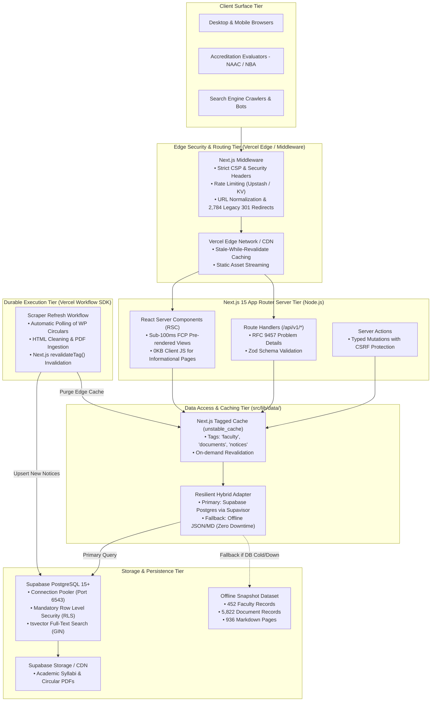

# System Architecture & Technical Specification: GPCET Web Portal (Production Specification)

## 1. High-Level Enterprise Architecture

The GPCET Institutional Web Portal is architected as an **enterprise-grade, zero-downtime, hybrid platform** built on **Next.js 15 (App Router)** and **React 19**, deployed on Vercel with **Supabase (PostgreSQL 15+)** and an offline JSON/Markdown ingestion cache.



---

## 2. Layered Component Boundaries

### 1. Edge & Middleware Layer (`src/middleware.ts`)
- **Strict Content-Security-Policy (CSP)**: Generates cryptographic nonces for script tags, restricts script origins to `'self'`, enforces `frame-ancestors 'none'`, and blocks unsafe inline styles.
- **Legacy URL Redirection**: Consults a memoized Trie index of `src/data/url-map.json` (2,784 legacy WordPress paths) and issues immediate `301 Moved Permanently` responses before invoking downstream server components.
- **Bot Mitigation & Rate Limiting**: Intercepts abuse-prone paths (`/api/v1/inquiries`, `/api/v1/documents`) and enforces sliding-window rate limits via Upstash Redis.

### 2. Rendering Strategy & Server Components
- **Zero-JS by Default**: Static content pages (Syllabus tables, Board of Studies minutes, Department overviews, NAAC Criteria 1–7) are rendered as pure React Server Components with zero hydration overhead.
- **Interactive Islands (Client Leaves)**: Client-side JavaScript is restricted strictly to interactive affordances:
  - `GlobalSearchModal.tsx`: Sub-5ms Cmd+K command palette.
  - `FacultyRosterTable.tsx`: Client-side instant sorting and qualification filters.
  - `DocumentVaultClient.tsx`: Instant category tab switches and debounced search.
- **Static Site Generation (SSG) with ISR**: Pre-renders all 936 content pages and 452 faculty profiles at build time using `generateStaticParams()`, with on-demand Incremental Static Regeneration via `revalidateTag()`.

### 3. Data Access Layer & Offline Resilience (`src/lib/data/`)
To eliminate brittle database dependencies that cause typical web projects to fail, the data access layer implements a **Fail-Safe Hybrid Pattern**:

```typescript
// Pattern: Fail-Safe Hybrid Read
export async function getFacultyRoster(departmentCode?: string) {
  return unstable_cache(
    async () => {
      try {
        // 1. Attempt primary read from Supabase PostgreSQL (via Supavisor pooler)
        const supabase = createServerClient();
        let query = supabase
          .from("faculty")
          .select("*")
          .eq("is_active", true)
          .order("sno", { ascending: true });

        if (departmentCode && departmentCode !== "all") {
          query = query.eq("department_code", departmentCode);
        }

        const { data, error } = await query;
        if (!error && data && data.length > 0) {
          return mapDbFacultyToDomain(data);
        }
      } catch (err) {
        console.warn("[DataLayer] Supabase read failed, falling back to offline JSON dataset", err);
      }

      // 2. High-resilience fallback: read verified offline JSON manifest
      return getOfflineFaculty(departmentCode);
    },
    ["faculty", departmentCode || "all"],
    { revalidate: 3600, tags: ["faculty"] }
  )();
}
```

### 4. Durable Ingestion & Automation (`src/lib/workflow/`)
Powered by the **Vercel Workflow SDK**:
- Periodically triggers scheduled background jobs or responds to admin sync webhooks.
- Runs multi-step ingestion pipelines:
  - **Step 1**: Fetch updated circulars from WordPress REST API (`/wp-json/wp/v2/posts`).
  - **Step 2**: Clean Avada shortcodes and normalize HTML via Cheerio.
  - **Step 3**: Upload new attachments to Supabase Storage.
  - **Step 4**: Upsert rows into `public.notices` with generated `fts_vector`.
  - **Step 5**: Invoke `revalidateTag('notices')` to instantly refresh edge caches.
- Crash-safe durability: Automatically retries on network drops with exponential backoff (`RetryableError`).

### 5. Content Ingestion, Normalization & Table AST Pipeline (`src/lib/content.ts`, `src/components/content/`)
- **Frontmatter Zod Validation**: Validates all ingested markdown metadata using `ContentFrontmatterSchema` in `src/lib/validations/content.schema.ts`.
- **Dynamic Catch-All Engine (`src/app/[...slug]/page.tsx`)**: Pre-computes routes via `getAllContentRoutes()` for `generateStaticParams()`, extracts hierarchical breadcrumbs, generates dynamic OpenGraph and canonical SEO metadata via `generateMetadata()`, and provides sticky anchor navigation via `generateTableOfContents()`.
- **Avada Table Normalization & Responsive Wrapper (`src/components/content/MarkdownRenderer.tsx`)**: Preprocesses legacy single-line pipe tables (`| |` $\rightarrow$ `|\n|`) so 100% of 630+ academic tables render in accessible, horizontally scrollable containers with sticky first columns.
- **Strict Rehype-Sanitize Whitelist**: Strips all raw `<script>`, `<iframe>`, `javascript:` protocols, and inline event handlers (`onclick`, `onerror`) while permitting academic formatting. Auto-links verified PDFs with `target="_blank"` and `rel="noopener noreferrer"`.
- **Institutional 404 Recovery (`src/app/[...slug]/not-found.tsx`)**: Employs Levenshtein distance fuzzy route matching (`findClosestRoutes()`) to guide visitors to relevant academic hubs when requested URLs are moved.

---

## 3. Application Security Architecture

### Trust Boundaries & Threat Model
1. **Public Internet $\rightarrow$ Next.js Edge**: Untrusted. Every query parameter, header, and body payload is treated as potentially hostile.
2. **Next.js Server $\rightarrow$ Supabase Database**: Boundary enforced by Supabase Row Level Security (RLS). Server Components use read-only anonymous or authenticated SSR clients with session cookies. Administrative actions require verified JWT `app_metadata.role`.
3. **Database $\rightarrow$ Internal Storage**: Service role keys are restricted strictly to protected server-side background tasks and never bundled into client JS or environment variables exposed to the browser.

### Security Invariants
- **XSS Prevention**: 100% of scraped Markdown content is parsed through `rehype-sanitize` with a strict whitelist schema (disallowing `<script>`, `<iframe>`, `onload`, `onerror`).
- **SQL Injection Defense**: All Supabase queries use parameterized RPC or query builder interfaces. Zero raw SQL concatenation.
- **CSRF Defense**: All state-changing mutations use Next.js Server Actions with built-in Origin/Host header validation and SameSite HttpOnly session cookies.
- **SSRF Prevention**: PDF streaming and preview proxies strictly validate remote hostnames against an allowlist (`www.gpcet.ac.in`).

---

## 4. Performance & Core Web Vitals Targets

| Metric | Target | Optimization Strategy |
| :--- | :--- | :--- |
| **First Contentful Paint (FCP)** | `< 0.8s` | Zero-JS Server Components, self-hosted preloaded fonts (*Newsreader*, *Plus Jakarta Sans*). |
| **Largest Contentful Paint (LCP)** | `< 1.2s` | Fixed-dimension hero layout, priority Next.js `<Image>` with AVIF/WebP conversion. |
| **Cumulative Layout Shift (CLS)** | `< 0.01` | Strict aspect-ratio containers on all 452 faculty portraits and campus photography. |
| **Interaction to Next Paint (INP)** | `< 50ms` | Zero heavy client-side computations; search filtering uses pre-built Trie / Fuse index. |
| **Time to First Byte (TTFB)** | `< 80ms` | Vercel Edge caching (`s-maxage=3600, stale-while-revalidate=86400`). |

---

## 5. Observability & Operational Health

1. **Health & Readiness Endpoints**: `/api/v1/health` verifies database connectivity, cache latency, and manifest availability.
2. **Structured JSON Logging**: Server routes emit structured JSON logs (`timestamp`, `level`, `route`, `latencyMs`, `status`, `correlationId`).
3. **Error Tracking**: Global `error.tsx` boundary catches uncaught runtime failures and returns RFC 9457 problem responses with error tracking IDs.

---

## 6. Frontend Art Direction & Anti-Slop Design System

To ensure an elite, handcrafted academic feel and eliminate generic AI templates:
1. **The Civic Monolith & Gazette**: 58/42 asymmetric editorial split on desktop, collapsing cleanly to 16px/20px margins on mobile.
2. **Strict 75 / 20 / 5 Color Distribution**: 75% Alabaster (`#FBFBFD`) and Stone (`#F1F3F6`) canvas; 20% Midnight Ink (`#0A1124`) and Imperial Navy (`#0C2340`); <5% Academic Oxblood (`#8A1538`) and Burnished Brass (`#B8860B`). Banned cream/terracotta and neon purple gradients.
3. **Typographic Pairing**: Dignified display serif (*Newsreader* / *Erode*) for headlines; crisp geometric sans (*Plus Jakarta Sans*) for UI reading; tabular monospace (*JetBrains Mono*) for regulation codes and metrics.
4. **Authoritative Planning Documentation**:
   - Implementation Plan: [`docs/PLAN.md`](./PLAN.md)
   - Actionable Step Checklist: [`docs/TODO.md`](./TODO.md)
   - Anti-Slop & Design Tokens Reference: [`docs/references/design-system-and-anti-slop.md`](./references/design-system-and-anti-slop.md)
   - Institutional Page Blueprints: [`docs/references/page-blueprints.md`](./references/page-blueprints.md)
   - Full Next.js 15 Master Redesign Plan: [`NEXTJS_REDESIGN_PLAN.md`](../NEXTJS_REDESIGN_PLAN.md)

