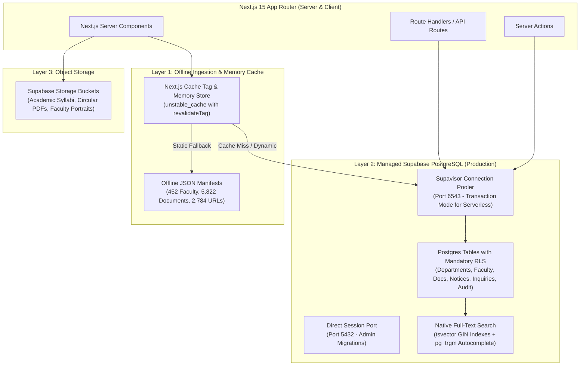

# Database & Schema Architecture: GPCET Web Portal (Production Specification)

## 1. High-Performance Hybrid Data Architecture

The GPCET web portal implements a dual-tier storage and access architecture designed for **sub-5ms page loads**, **zero runtime single-points-of-failure**, and **high-resilience institutional data management**:



### Architectural Guarantees
1. **Zero-Downtime Offline Fallback**: All core read queries (faculty rosters, academic documents, department overviews) first consult the cached/snapshotted JSON dataset in `src/data/`. If Supabase PostgreSQL is temporarily unreachable or experiences cold starts, the application gracefully degrades to offline JSON without throwing 500 errors.
2. **Serverless Connection Management**: All serverless Next.js functions connect via Supabase's **Supavisor connection pooler on port 6543** in transaction pooling mode. This prevents PostgreSQL connection exhaustion during sudden traffic spikes (e.g. EAPCET admissions, exam results announcements).
3. **Data Integrity & Immutability**: All institutional records are tracked via an append-only `audit_logs` table managed by database triggers. Deletions are soft (`is_active = FALSE`).

---

## 2. Complete PostgreSQL Schema Definition

The following SQL migration defines the complete relational model, constraints, and extensions.

```sql
-- ============================================================================
-- 001_core_schema.sql: GPCET Institutional Web Portal Schema
-- Target: PostgreSQL 15+ (Supabase)
-- ============================================================================

-- 1. Enable Required Extensions
CREATE EXTENSION IF NOT EXISTS "pgcrypto";     -- Native gen_random_uuid()
CREATE EXTENSION IF NOT EXISTS "pg_trgm";      -- Trigram similarity search
CREATE EXTENSION IF NOT EXISTS "unaccent";     -- Accent-insensitive search
CREATE EXTENSION IF NOT EXISTS "btree_gist";   -- Advanced exclusion constraints

-- 2. Enumerated Types
DO $$ BEGIN
    CREATE TYPE public.faculty_cadre AS ENUM (
        'professor_hod',
        'professor',
        'associate_professor',
        'assistant_professor',
        'adjunct_faculty',
        'technical_staff',
        'administrative'
    );
EXCEPTION
    WHEN duplicate_object THEN null;
END $$;

DO $$ BEGIN
    CREATE TYPE public.notice_category AS ENUM (
        'circular',
        'examination',
        'admissions',
        'recruitment',
        'academic_calendar',
        'event',
        'tender',
        'statutory'
    );
EXCEPTION
    WHEN duplicate_object THEN null;
END $$;

DO $$ BEGIN
    CREATE TYPE public.notice_priority AS ENUM ('urgent', 'high', 'normal');
EXCEPTION
    WHEN duplicate_object THEN null;
END $$;

DO $$ BEGIN
    CREATE TYPE public.inquiry_status AS ENUM ('new', 'contacted', 'verified', 'admitted', 'rejected', 'archived');
EXCEPTION
    WHEN duplicate_object THEN null;
END $$;

-- 3. Departments Table (Institutional Core)
CREATE TABLE IF NOT EXISTS public.departments (
    code VARCHAR(10) PRIMARY KEY, -- 'cse', 'ai', 'ece', 'eee', 'me', 'civil', 'hs', 'mba'
    name VARCHAR(255) NOT NULL,
    short_name VARCHAR(50) NOT NULL,
    established_year INT NOT NULL CHECK (established_year >= 1990 AND established_year <= 2100),
    intake_ug INT DEFAULT 0 CHECK (intake_ug >= 0),
    intake_pg INT DEFAULT 0 CHECK (intake_pg >= 0),
    nba_accredited BOOLEAN DEFAULT FALSE,
    nba_valid_upto DATE,
    hod_faculty_id UUID, -- Foreign key added below after faculty table creation
    vision TEXT NOT NULL,
    mission TEXT[] NOT NULL,
    contact_email VARCHAR(255) NOT NULL,
    contact_phone VARCHAR(50),
    is_active BOOLEAN DEFAULT TRUE NOT NULL,
    created_at TIMESTAMPTZ DEFAULT TIMEZONE('utc', NOW()) NOT NULL,
    updated_at TIMESTAMPTZ DEFAULT TIMEZONE('utc', NOW()) NOT NULL
);

-- 4. Academic Regulations Table
CREATE TABLE IF NOT EXISTS public.academic_regulations (
    id UUID PRIMARY KEY DEFAULT gen_random_uuid(),
    code VARCHAR(20) UNIQUE NOT NULL, -- 'R20', 'R19', 'R18', 'R15'
    name VARCHAR(100) NOT NULL,
    program_type VARCHAR(20) NOT NULL CHECK (program_type IN ('UG', 'PG', 'MBA')),
    effective_from_year INT NOT NULL,
    effective_to_year INT,
    is_current BOOLEAN DEFAULT FALSE NOT NULL,
    syllabus_summary_url TEXT,
    created_at TIMESTAMPTZ DEFAULT TIMEZONE('utc', NOW()) NOT NULL
);

-- 5. Faculty Profiles Table (452 Verified Records)
CREATE TABLE IF NOT EXISTS public.faculty (
    id UUID PRIMARY KEY DEFAULT gen_random_uuid(),
    department_code VARCHAR(10) REFERENCES public.departments(code) ON UPDATE CASCADE ON DELETE RESTRICT NOT NULL,
    sno INT NOT NULL,
    name VARCHAR(255) NOT NULL,
    slug VARCHAR(255) NOT NULL,
    cadre public.faculty_cadre DEFAULT 'assistant_professor' NOT NULL,
    designation VARCHAR(150) NOT NULL,
    highest_qualification VARCHAR(255) DEFAULT '' NOT NULL,
    experience_years NUMERIC(4, 1) DEFAULT 0.0 CHECK (experience_years >= 0),
    email VARCHAR(255),
    phone VARCHAR(50),
    photo_url TEXT,
    profile_route TEXT, -- Nullable: 242/452 records lack dedicated individual profile pages
    is_hod BOOLEAN DEFAULT FALSE NOT NULL,
    bio TEXT,
    specializations TEXT[] DEFAULT '{}',
    degrees JSONB DEFAULT '[]'::jsonb, -- Array of { degree, field, institution, year }
    publications JSONB DEFAULT '[]'::jsonb, -- Array of { title, journal, year, doi, citationUrl }
    patents JSONB DEFAULT '[]'::jsonb, -- Array of { title, patentNumber, status, year }
    subjects_taught TEXT[] DEFAULT '{}',
    is_active BOOLEAN DEFAULT TRUE NOT NULL,
    created_at TIMESTAMPTZ DEFAULT TIMEZONE('utc', NOW()) NOT NULL,
    updated_at TIMESTAMPTZ DEFAULT TIMEZONE('utc', NOW()) NOT NULL,
    CONSTRAINT uq_faculty_dept_slug UNIQUE (department_code, slug)
);

-- Add deferred foreign key to departments
ALTER TABLE public.departments 
    ADD CONSTRAINT fk_dept_hod 
    FOREIGN KEY (hod_faculty_id) 
    REFERENCES public.faculty(id) 
    ON DELETE SET NULL;

-- 6. Academic Documents & Media Manifest (5,822 Cataloged Files)
CREATE TABLE IF NOT EXISTS public.academic_documents (
    id UUID PRIMARY KEY DEFAULT gen_random_uuid(),
    department_code VARCHAR(10) REFERENCES public.departments(code) ON UPDATE CASCADE ON DELETE SET NULL,
    regulation_id UUID REFERENCES public.academic_regulations(id) ON UPDATE CASCADE ON DELETE SET NULL,
    title VARCHAR(500) NOT NULL,
    slug VARCHAR(500) NOT NULL,
    category VARCHAR(50) NOT NULL CHECK (category IN (
        'syllabus', 'general_pdf', 'academic_calendar', 'general_image', 
        'campus_photo', 'faculty_photo', 'logo_badge', 'accreditation_doc', 
        'video', 'other', 'form_affidavit', 'circular', 'exam_timetable', 
        'lecture_presentation', 'regulation', 'governance', 'placement'
    )),
    academic_year VARCHAR(20), -- e.g. '2026-2027'
    semester VARCHAR(20),      -- e.g. 'I-I', 'IV-II'
    file_url TEXT NOT NULL,
    file_size_bytes BIGINT CHECK (file_size_bytes >= 0),
    mime_type VARCHAR(100) DEFAULT 'application/pdf' NOT NULL,
    download_count INT DEFAULT 0 NOT NULL,
    is_published BOOLEAN DEFAULT TRUE NOT NULL,
    -- Generated full-text search vector combining title and category
    fts_vector tsvector GENERATED ALWAYS AS (
        setweight(to_tsvector('english', coalesce(title, '')), 'A') ||
        setweight(to_tsvector('english', coalesce(category, '')), 'B') ||
        setweight(to_tsvector('english', coalesce(academic_year, '')), 'C')
    ) STORED,
    created_at TIMESTAMPTZ DEFAULT TIMEZONE('utc', NOW()) NOT NULL,
    updated_at TIMESTAMPTZ DEFAULT TIMEZONE('utc', NOW()) NOT NULL
);

-- 7. Institutional Notices, Circulars & Marquee Ticker
CREATE TABLE IF NOT EXISTS public.notices (
    id UUID PRIMARY KEY DEFAULT gen_random_uuid(),
    department_code VARCHAR(10) REFERENCES public.departments(code) ON UPDATE CASCADE ON DELETE SET NULL,
    title VARCHAR(500) NOT NULL,
    slug VARCHAR(500) UNIQUE NOT NULL,
    summary VARCHAR(500),
    content_markdown TEXT NOT NULL,
    category public.notice_category DEFAULT 'circular' NOT NULL,
    priority public.notice_priority DEFAULT 'normal' NOT NULL,
    is_ticker BOOLEAN DEFAULT FALSE NOT NULL,
    is_pinned BOOLEAN DEFAULT FALSE NOT NULL,
    attachment_url TEXT,
    attachment_size_bytes BIGINT,
    published_at TIMESTAMPTZ DEFAULT TIMEZONE('utc', NOW()) NOT NULL,
    expires_at TIMESTAMPTZ,
    author_id UUID REFERENCES auth.users(id) ON DELETE SET NULL,
    is_active BOOLEAN DEFAULT TRUE NOT NULL,
    -- Full-text search vector
    fts_vector tsvector GENERATED ALWAYS AS (
        setweight(to_tsvector('english', coalesce(title, '')), 'A') ||
        setweight(to_tsvector('english', coalesce(summary, '')), 'B') ||
        setweight(to_tsvector('english', coalesce(content_markdown, '')), 'C')
    ) STORED,
    created_at TIMESTAMPTZ DEFAULT TIMEZONE('utc', NOW()) NOT NULL,
    updated_at TIMESTAMPTZ DEFAULT TIMEZONE('utc', NOW()) NOT NULL
);

-- 8. Admissions Inquiries (Protected Submissions)
CREATE TABLE IF NOT EXISTS public.admissions_inquiries (
    id UUID PRIMARY KEY DEFAULT gen_random_uuid(),
    student_name VARCHAR(150) NOT NULL CHECK (char_length(trim(student_name)) >= 2),
    email VARCHAR(255) NOT NULL CHECK (email ~* '^[A-Za-z0-9._%+-]+@[A-Za-z0-9.-]+\.[A-Za-z]{2,}$'),
    phone VARCHAR(30) NOT NULL CHECK (char_length(trim(phone)) >= 10),
    desired_department VARCHAR(10) REFERENCES public.departments(code) ON UPDATE CASCADE ON DELETE RESTRICT NOT NULL,
    program VARCHAR(20) DEFAULT 'B.Tech' NOT NULL CHECK (program IN ('B.Tech', 'M.Tech', 'MBA')),
    eamcet_rank INT CHECK (eamcet_rank IS NULL OR eamcet_rank > 0),
    message TEXT CHECK (char_length(message) <= 2000),
    ip_hash VARCHAR(64) NOT NULL, -- SHA-256 hash of client IP for rate limiting / abuse detection
    user_agent VARCHAR(500),
    status public.inquiry_status DEFAULT 'new' NOT NULL,
    internal_notes TEXT,
    assigned_counselor_id UUID REFERENCES auth.users(id) ON DELETE SET NULL,
    created_at TIMESTAMPTZ DEFAULT TIMEZONE('utc', NOW()) NOT NULL,
    updated_at TIMESTAMPTZ DEFAULT TIMEZONE('utc', NOW()) NOT NULL
);

-- 9. Append-Only System Audit Logs
CREATE TABLE IF NOT EXISTS public.audit_logs (
    id UUID PRIMARY KEY DEFAULT gen_random_uuid(),
    table_name VARCHAR(100) NOT NULL,
    record_id TEXT NOT NULL, -- TEXT accommodates both UUIDs and string keys (e.g. departments.code)
    action VARCHAR(20) NOT NULL CHECK (action IN ('INSERT', 'UPDATE', 'DELETE', 'RESTORE')),
    old_data JSONB,
    new_data JSONB,
    performed_by UUID REFERENCES auth.users(id) ON DELETE SET NULL,
    client_ip_hash VARCHAR(64),
    created_at TIMESTAMPTZ DEFAULT TIMEZONE('utc', NOW()) NOT NULL
);
```

---

## 3. High-Performance Indexing Strategy

Targeted B-Tree, partial, and GIN indexes guarantee sub-millisecond query execution even under peak admission traffic:

```sql
-- ============================================================================
-- 002_indexes.sql: Indexing & Query Acceleration
-- ============================================================================

-- A. Foreign Key B-Tree Indexes (prevents table scans during joins and deletes)
CREATE INDEX IF NOT EXISTS idx_faculty_dept ON public.faculty(department_code);
CREATE INDEX IF NOT EXISTS idx_docs_dept ON public.academic_documents(department_code);
CREATE INDEX IF NOT EXISTS idx_docs_reg ON public.academic_documents(regulation_id);
CREATE INDEX IF NOT EXISTS idx_notices_dept ON public.notices(department_code);
CREATE INDEX IF NOT EXISTS idx_inquiries_dept ON public.admissions_inquiries(desired_department);

-- B. Selective Partial Indexes (drastically smaller memory footprint)
-- Ticker circulars for the instant homepage banner
CREATE INDEX IF NOT EXISTS idx_notices_ticker_active 
    ON public.notices (published_at DESC) 
    WHERE is_ticker = TRUE AND is_active = TRUE;

-- Active pinned notices
CREATE INDEX IF NOT EXISTS idx_notices_pinned_active 
    ON public.notices (priority, published_at DESC) 
    WHERE is_pinned = TRUE AND is_active = TRUE;

-- Active faculty ordering
CREATE INDEX IF NOT EXISTS idx_faculty_active_sort 
    ON public.faculty (department_code, cadre, sno ASC) 
    WHERE is_active = TRUE;

-- Document categorization index
CREATE INDEX IF NOT EXISTS idx_docs_cat_year 
    ON public.academic_documents (category, academic_year DESC) 
    WHERE is_published = TRUE;

-- Recent inquiries requiring counselor action
CREATE INDEX IF NOT EXISTS idx_inquiries_pending 
    ON public.admissions_inquiries (created_at DESC) 
    WHERE status = 'new';

-- C. Native Full-Text Search (GIN) Indexes
CREATE INDEX IF NOT EXISTS idx_docs_fts ON public.academic_documents USING GIN (fts_vector);
CREATE INDEX IF NOT EXISTS idx_notices_fts ON public.notices USING GIN (fts_vector);

-- D. Trigram (pg_trgm) Indexes for Substring Autocomplete
CREATE INDEX IF NOT EXISTS idx_faculty_name_trgm ON public.faculty USING GIN (name gin_trgm_ops);
CREATE INDEX IF NOT EXISTS idx_docs_title_trgm ON public.academic_documents USING GIN (title gin_trgm_ops);
```

---

## 4. Row Level Security (RLS) & Access Control Matrix

In accordance with Supabase Postgres security best practices, **RLS is mandatory on every public table**. Anonymous internet users (`anon`) have strictly bounded read permissions and tightly validated submission privileges. Administrative mutations require cryptographically verified roles from `app_metadata`.

```sql
-- ============================================================================
-- 003_security_rls.sql: Row Level Security Policies
-- ============================================================================

-- 1. Enable RLS across all tables
ALTER TABLE public.departments ENABLE ROW LEVEL SECURITY;
ALTER TABLE public.academic_regulations ENABLE ROW LEVEL SECURITY;
ALTER TABLE public.faculty ENABLE ROW LEVEL SECURITY;
ALTER TABLE public.academic_documents ENABLE ROW LEVEL SECURITY;
ALTER TABLE public.notices ENABLE ROW LEVEL SECURITY;
ALTER TABLE public.admissions_inquiries ENABLE ROW LEVEL SECURITY;
ALTER TABLE public.audit_logs ENABLE ROW LEVEL SECURITY;

-- Helper function: Check caller role from secure app_metadata (never raw_user_meta_data)
CREATE OR REPLACE FUNCTION public.current_user_role()
RETURNS TEXT
LANGUAGE sql
STABLE
AS $$
    SELECT COALESCE(
        auth.jwt() -> 'app_metadata' ->> 'role',
        'anon'
    );
$$;

-- Helper function: Check if user has administrative or editor privileges
CREATE OR REPLACE FUNCTION public.is_staff()
RETURNS BOOLEAN
LANGUAGE sql
STABLE
AS $$
    SELECT public.current_user_role() IN ('admin', 'editor', 'counselor', 'hod');
$$;

-- 2. Public Read Policies with Staff Visibility Bypasses (Prevents RLS update/select lockouts)
CREATE POLICY "Public and staff can view departments" 
    ON public.departments FOR SELECT 
    TO anon, authenticated 
    USING (is_active = TRUE OR public.is_staff());

CREATE POLICY "Public can view regulations" 
    ON public.academic_regulations FOR SELECT 
    TO anon, authenticated 
    USING (TRUE);

CREATE POLICY "Public and staff can view faculty" 
    ON public.faculty FOR SELECT 
    TO anon, authenticated 
    USING (is_active = TRUE OR public.is_staff());

CREATE POLICY "Public and staff can view documents" 
    ON public.academic_documents FOR SELECT 
    TO anon, authenticated 
    USING (is_published = TRUE OR public.is_staff());

CREATE POLICY "Public and staff can view notices" 
    ON public.notices FOR SELECT 
    TO anon, authenticated 
    USING (
        (
            is_active = TRUE 
            AND published_at <= TIMEZONE('utc', NOW())
            AND (expires_at IS NULL OR expires_at > TIMEZONE('utc', NOW()))
        ) 
        OR public.is_staff()
    );

-- 3. Admissions Inquiries Security (Submit-Only for Public, Strict Read for Staff)
CREATE POLICY "Public can submit inquiries" 
    ON public.admissions_inquiries FOR INSERT 
    TO anon, authenticated 
    WITH CHECK (
        status = 'new' 
        AND char_length(student_name) >= 2 
        AND char_length(phone) >= 10
    );

CREATE POLICY "Counselors and admins can view inquiries" 
    ON public.admissions_inquiries FOR SELECT 
    TO authenticated 
    USING (public.current_user_role() IN ('admin', 'counselor'));

CREATE POLICY "Counselors and admins can update inquiries" 
    ON public.admissions_inquiries FOR UPDATE 
    TO authenticated 
    USING (public.current_user_role() IN ('admin', 'counselor'))
    WITH CHECK (public.current_user_role() IN ('admin', 'counselor'));

CREATE POLICY "Admins can delete inquiries" 
    ON public.admissions_inquiries FOR DELETE 
    TO authenticated 
    USING (public.current_user_role() = 'admin');

-- 4. Administrative Mutation Policies (Staff Only)
CREATE POLICY "Admins can manage departments" 
    ON public.departments FOR ALL 
    TO authenticated 
    USING (public.current_user_role() = 'admin')
    WITH CHECK (public.current_user_role() = 'admin');

CREATE POLICY "Staff can manage regulations" 
    ON public.academic_regulations FOR ALL 
    TO authenticated 
    USING (public.current_user_role() IN ('admin', 'editor'))
    WITH CHECK (public.current_user_role() IN ('admin', 'editor'));

CREATE POLICY "Staff can manage notices" 
    ON public.notices FOR ALL 
    TO authenticated 
    USING (public.current_user_role() IN ('admin', 'editor'))
    WITH CHECK (public.current_user_role() IN ('admin', 'editor'));

CREATE POLICY "Staff can manage documents" 
    ON public.academic_documents FOR ALL 
    TO authenticated 
    USING (public.current_user_role() IN ('admin', 'editor'))
    WITH CHECK (public.current_user_role() IN ('admin', 'editor'));

CREATE POLICY "Staff can manage faculty" 
    ON public.faculty FOR ALL 
    TO authenticated 
    USING (public.current_user_role() IN ('admin', 'editor', 'hod'))
    WITH CHECK (public.current_user_role() IN ('admin', 'editor', 'hod'));

-- 5. Audit Log Security (Append-only by trigger, viewable strictly by super-admin)
CREATE POLICY "Only admins can view audit logs" 
    ON public.audit_logs FOR SELECT 
    TO authenticated 
    USING (public.current_user_role() = 'admin');
```

---

## 5. Automated Audit Logging & Timestamp Triggers

```sql
-- ============================================================================
-- 004_triggers.sql: Maintenance & Audit Triggers
-- ============================================================================

-- A. Generic updated_at trigger function
CREATE OR REPLACE FUNCTION public.handle_updated_at()
RETURNS TRIGGER 
LANGUAGE plpgsql
AS $$
BEGIN
    NEW.updated_at = TIMEZONE('utc', NOW());
    RETURN NEW;
END;
$$;

-- Apply updated_at triggers
CREATE TRIGGER trg_dept_updated_at BEFORE UPDATE ON public.departments FOR EACH ROW EXECUTE FUNCTION public.handle_updated_at();
CREATE TRIGGER trg_faculty_updated_at BEFORE UPDATE ON public.faculty FOR EACH ROW EXECUTE FUNCTION public.handle_updated_at();
CREATE TRIGGER trg_docs_updated_at BEFORE UPDATE ON public.academic_documents FOR EACH ROW EXECUTE FUNCTION public.handle_updated_at();
CREATE TRIGGER trg_notices_updated_at BEFORE UPDATE ON public.notices FOR EACH ROW EXECUTE FUNCTION public.handle_updated_at();
CREATE TRIGGER trg_inquiries_updated_at BEFORE UPDATE ON public.admissions_inquiries FOR EACH ROW EXECUTE FUNCTION public.handle_updated_at();

-- B. Audit logging trigger function (Universal for UUID and natural string PKs)
CREATE OR REPLACE FUNCTION public.handle_audit_log()
RETURNS TRIGGER 
LANGUAGE plpgsql
SECURITY DEFINER
AS $$
DECLARE
    v_record_id TEXT;
    v_old_data JSONB := NULL;
    v_new_data JSONB := NULL;
BEGIN
    IF (TG_OP = 'DELETE') THEN
        v_old_data := to_jsonb(OLD);
        v_record_id := COALESCE(v_old_data->>'id', v_old_data->>'code', 'unknown');
    ELSIF (TG_OP = 'UPDATE') THEN
        v_old_data := to_jsonb(OLD);
        v_new_data := to_jsonb(NEW);
        v_record_id := COALESCE(v_new_data->>'id', v_new_data->>'code', 'unknown');
    ELSIF (TG_OP = 'INSERT') THEN
        v_new_data := to_jsonb(NEW);
        v_record_id := COALESCE(v_new_data->>'id', v_new_data->>'code', 'unknown');
    END IF;

    INSERT INTO public.audit_logs (
        table_name,
        record_id,
        action,
        old_data,
        new_data,
        performed_by
    ) VALUES (
        TG_TABLE_NAME,
        v_record_id,
        TG_OP,
        v_old_data,
        v_new_data,
        auth.uid()
    );

    RETURN COALESCE(NEW, OLD);
END;
$$;

-- Audit critical tables
CREATE TRIGGER trg_audit_departments AFTER INSERT OR UPDATE OR DELETE ON public.departments FOR EACH ROW EXECUTE FUNCTION public.handle_audit_log();
CREATE TRIGGER trg_audit_notices AFTER INSERT OR UPDATE OR DELETE ON public.notices FOR EACH ROW EXECUTE FUNCTION public.handle_audit_log();
CREATE TRIGGER trg_audit_inquiries AFTER INSERT OR UPDATE OR DELETE ON public.admissions_inquiries FOR EACH ROW EXECUTE FUNCTION public.handle_audit_log();
CREATE TRIGGER trg_audit_faculty AFTER INSERT OR UPDATE OR DELETE ON public.faculty FOR EACH ROW EXECUTE FUNCTION public.handle_audit_log();
CREATE TRIGGER trg_audit_docs AFTER INSERT OR UPDATE OR DELETE ON public.academic_documents FOR EACH ROW EXECUTE FUNCTION public.handle_audit_log();
```

---

## 6. Offline Seeding Pipeline & Data Migration

To populate the database from the offline scraper extraction:
1. **Departments**: Seeded from `content/departments/*/` metadata.
2. **Faculty**: Ingested directly from the 8 JSON files in `src/data/faculty/*.json` (**452 faculty profiles**).
3. **Academic Documents**: Seeded from `src/data/media-manifest.json` (**5,822 indexed documents**).
4. **Offline Fallback Guarantee**: If the database is not provisioned or credentials are absent during local development, the TypeScript data access layer (`src/lib/data/`) transparently reads directly from `src/data/` without configuration changes.
